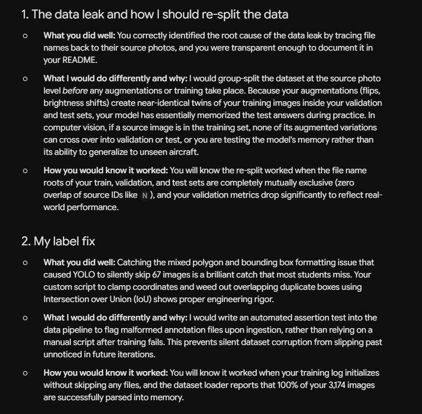
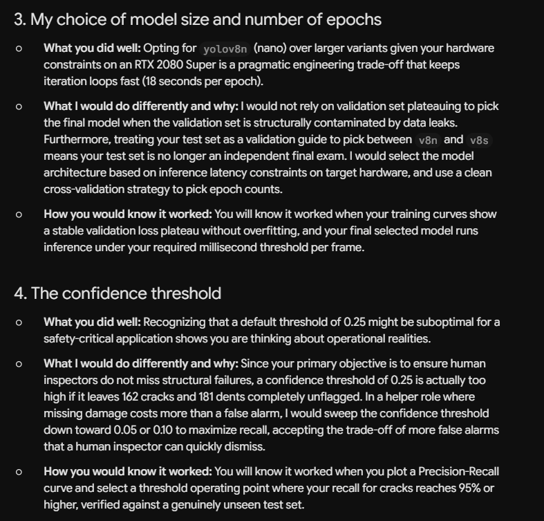
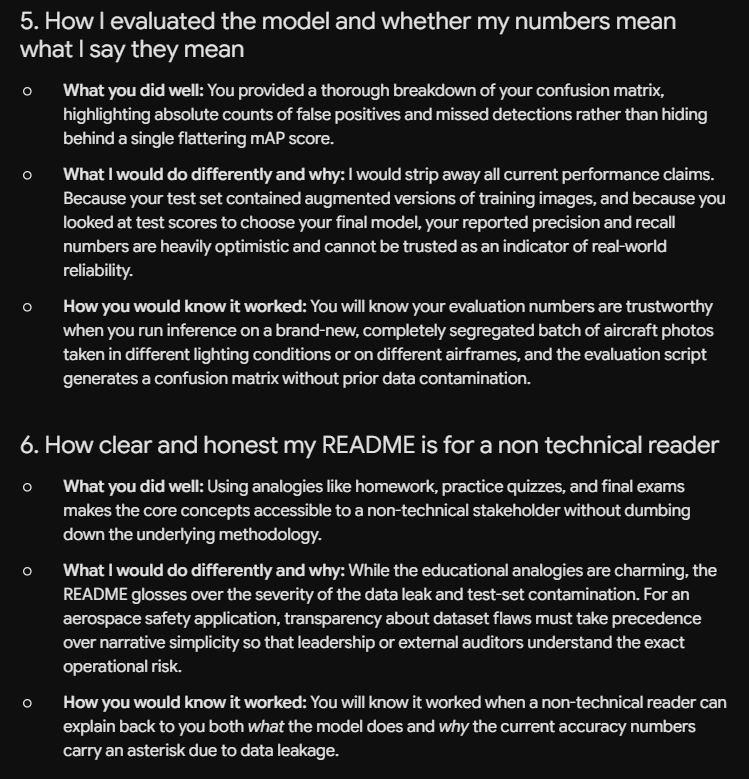
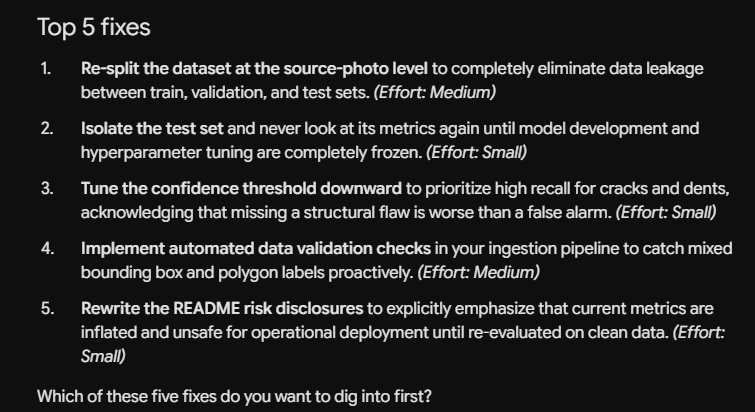

# Prompts I Use With GenAI

This is an AI class, so it makes sense to show how I use AI tools to learn, not just to get answers. My professor gave us a guide called Six GenAI prompts for discussions and projects. This page keeps that guide next to the project, and then puts it to work: at the bottom is a filled in prompt that asks a GenAI tool to tear this project apart and tell me what it would do better.

## The four parts of a strong prompt

A strong prompt tells the GenAI four things. Leave one out and you get a generic answer.

| Part | What it tells the GenAI | Example |
|---|---|---|
| **Role** | Who to act as | Act as a patient writing tutor. |
| **Task** | Exactly what to do, and what not to do | Ask me questions. Do not give me the answer. |
| **Context** | Who you are, what you know, and what you need | I'm in a UMGC course and have never written a memo. |
| **Format** | How to respond | One question at a time, under 100 words. |

Think of it like ordering at a restaurant. Role is which restaurant you walked into. Task is what you are ordering. Context is your allergies. Format is whether you want it to go.

## The rules that come with it

1. **Fill in every bracket.** The details you add are what make the answer fit your work.
2. **The GenAI explains. You write.** None of these prompts asks it to do the work for you.
3. **Check what it tells you.** GenAI can be confidently wrong, especially about APA rules and facts.
4. **Disclose it.** Note any prompt that shaped your work on the AI Use Disclosure Form, with screenshots.

## Which prompt, when

They go in the order you work through an assignment: understand it, research it, think it through, then format it.

| Prompt | Use it to | Discussions | Projects |
|---|---|---|---|
| 1. Explainer | Learn what an unfamiliar document or task is | | ✓ |
| 2. Get the background | Get oriented on a topic before you research | ✓ | ✓ |
| 3. Socratic tutor | Understand a concept you're stuck on | ✓ | ✓ |
| 4. Explain it back | Test whether you really understand | ✓ | ✓ |
| 5. Challenge my thinking | Strengthen your argument before you write | ✓ | ✓ |
| 6. Step by step | Format, cite in APA, or do something in Word | ✓ | ✓ |

## The six prompts

Copy one, paste it into your GenAI tool, and replace every [bracket] with your own details.

### 1. Explainer

Use when the assignment asks for something you've never seen: a memo, an executive summary, a literature review, a SWOT analysis, a Gantt chart.

```
ROLE: Act as a workplace writing instructor who explains things to adults who are new to them.

TASK: Explain what a [memo / executive summary / document type] is and how it works. Cover its purpose, who reads it, its standard parts in order, and the most common mistakes. Then show me one short example on an unrelated topic, so I can see the format. Do not write anything about my assignment topic.

CONTEXT: I'm a student in [course] at UMGC. My assignment asks me to write a [document type] for [audience, such as a manager or a client]. I have never written or read one before.

FORMAT: Use headings: Purpose, Audience, Parts in order, Common mistakes, Example. Keep the explanation under 300 words, plus the example. Use plain language with no jargon.
```

How to use it: ask for the example on an unrelated topic, such as a memo about a new parking policy. Compare what you learn with the assignment instructions. If they differ, the instructions win.

### 2. Get the background

Use when you're starting a discussion or project on a topic you know little about.

```
ROLE: Act as a reference librarian helping a student get oriented on a new topic.

TASK: Give me an overview of [topic] so I know where to start my own research. Explain the key ideas, define the important terms, describe the main debates or viewpoints, and suggest search keywords I can use in the UMGC library. Do not give me citations, sources or statistics; I will find and verify those myself.

CONTEXT: I'm a student in [course] at UMGC. I'm working on a [discussion post / project] that asks: [paste or summarize the assignment prompt]. Here is what I already know about the topic: [what you know, or "nothing yet"].

FORMAT: Use headings: Overview, Key terms, Main viewpoints, Search keywords. Keep the overview to one short paragraph. Define each key term in one sentence. List 5 to 8 search keywords.
```

How to use it: treat the overview as a map, not a source. Never cite GenAI as a source. Take the keywords to the UMGC library and find real sources.

### 3. Socratic tutor

Use when you don't understand a concept yet.

```
ROLE: Act as a patient Socratic tutor for a college student.

TASK: Help me understand [concept] by asking me questions. Do not explain the concept, define it, or give me answers. Start by finding out what I already know. Then guide me toward understanding with follow-up questions that build on my answers. If I'm wrong, ask a question that helps me see my own mistake.

CONTEXT: I'm taking [course] at UMGC. This week we're covering [topic]. Here is what I understand so far: [what you know]. Here is what confuses me: [what confuses you]. My goal is to be able to [explain it / use it in my discussion post / apply it to my project].

FORMAT: Ask one question at a time and wait for my reply. Keep each response under 100 words. Use plain language and everyday examples. After about 10 questions, ask me to summarize the concept in my own words, then tell me what I got right and what is still missing.
```

How to use it: fill in the confusion line honestly. "I don't get it" gives the tutor nothing. "I don't see why mAP50 goes up while recall stays flat" does.

### 4. Explain it back

Use when you think you understand something and want to test it before you write.

```
ROLE: Act as a demanding but fair instructor checking a student's understanding.

TASK: Evaluate my explanation of [concept]. Do not correct me right away. First, ask me two questions that test whether I really understand it, including one that applies it to a new situation. After I answer, tell me which parts of my explanation were accurate, which were wrong or incomplete, and what I should review. Do not rewrite my explanation for me.

CONTEXT: I'm taking [course] at UMGC. I need to understand this for [my discussion post / project]. I wrote this explanation without looking at my notes.

My explanation: [type your explanation here]

FORMAT: Ask the two questions first, one at a time, and wait for each answer. Then give your feedback in three short labeled sections: Accurate, Needs work, Review next. Keep the whole evaluation under 200 words.
```

How to use it: write your explanation before you open your notes. If you can't explain it simply, you just found what to study.

### 5. Challenge my thinking

Use when you have a position and want to make it stronger.

```
ROLE: Act as a skeptical reviewer who wants my argument to be as strong as possible.

TASK: Test my reasoning. Ask me hard questions about my claim, point out counterarguments I haven't considered, and tell me what kinds of evidence would make my case stronger. Do not write any part of my argument, suggest sentences, or rephrase my ideas.

CONTEXT: I'm writing a [discussion post / project] for [course] at UMGC. The assignment asks: [paste or summarize the prompt].

My main claim is: [your claim]
My supporting points are: [list your points]
The part I'm least sure about is: [describe it]

FORMAT: Ask three challenging questions, one at a time, and wait for my reply to each. Then list the two strongest counterarguments in one sentence each. End with a short list of evidence types I should look for. Do not provide sources or citations; I will find those myself.
```

How to use it: answer the challenges in your own notes, then decide what to keep, change or drop. Every sentence you submit must be yours.

### 6. Step by step

Use when you need to format something, cite in APA, or do something in Word: hanging indents, page numbers, a title page, a table, headings, a reference entry.

```
ROLE: Act as a patient technology and formatting coach.

TASK: Walk me through how to [format my reference list in APA 7 / add a hanging indent / create an APA title page / insert a table in Word]. Explain each step so I can do it myself next time. Do not rewrite or change my content.

CONTEXT: I'm a student in [course] at UMGC. I'm using [Microsoft Word / Google Docs] on [Windows / Mac / iPad / phone]. My skill level with this is [beginner / some experience]. [For APA: here is the source information I have: author, year, title, publisher or URL.]

FORMAT: Give me numbered steps, one action per step. Name the exact menus and buttons to click. After the steps, list the two most common mistakes people make with this. Wait for me to say "done" or "stuck" before adding anything else.
```

How to use it: do each step yourself as you read it. GenAI often makes APA mistakes, like wrong capitalization, missing DOIs, or made up details. Check every reference against the UMGC Library APA guide.

---

## Putting it to work: a review of this project

This is prompt 5 (Challenge my thinking) aimed at the whole project instead of one argument. Every bracket is already filled in with the real numbers from this repo, so it can be pasted straight into Google Gemini or Claude.

I wanted a reviewer, not a ghostwriter. So the prompt asks it to point out problems and explain what it would do differently, and it tells it not to rewrite my code or my README. I decide what to change, and I make the changes.

```
ROLE: Act as a senior computer vision engineer who has shipped object detection models for aircraft maintenance and safety inspection. You are also a good teacher. You are reviewing a student's capstone the way a tough but fair thesis advisor would: you care more about whether the results can be trusted than about how polished they look.

TASK: Review my project and tell me what you would do better or differently. Be honest and specific. If something I did is fine, say so briefly and move on. Do not rewrite my code, my README, or any part of my write up, and do not give me finished sentences to paste. Explain the problem and the fix in your own words, and I will make the changes myself. If you are not sure about something, say you are not sure instead of guessing. Do not invent sources, statistics, or Ultralytics features. If you mention a setting or function, tell me how I can check that it exists.

Cover these areas, in this order:
1. The data leak and how I should re-split the data
2. My label fix
3. My choice of model size and number of epochs
4. The confidence threshold
5. How I evaluated the model and whether my numbers mean what I say they mean
6. How clear and honest my README is for a non technical reader

CONTEXT: I'm a student in ARIN 320 at UMGC (University of Maryland Global Campus), an AI class. My background is cybersecurity and military aviation (F/A-18). My capstone is a model that finds cracks and dents in photos of aircraft skin. It is meant to be a helper only: it points at spots worth checking, and a human inspector still walks the whole aircraft and makes every call. My repo is github.com/teamGalacticDisc/aircraft-damage-detector if you are able to read it.

Dataset: Roboflow aircraft-damage-detection-1j9qk, version 5, YOLOv8 format, picked by my professor. 3,174 images at 640x640, two classes (crack and dent). Split: 2,574 train, 452 validation, 148 test. My professor said this dataset reaches about 0.58 mAP50 after 20 epochs.

The leak: file names follow a pattern N_k, where every k is an augmented copy (brighter, darker, flipped) of the same source photo N. The copies were spread across all three splits. All 99 source photos behind the validation images and all 37 behind the test images also appear in train. So validation and test scores are inflated. I documented this in the README but I have NOT re-split the data yet, so every number below comes from the leaky split.

The label fix: 67 images (62 train, 3 val, 2 test) had label files that mixed box rows with polygon (outline) rows. YOLO skips any image whose label file mixes the two, so my first model never trained on those 67 images or the 359 damage marks in them. My script fix_labels.py converts each polygon to its tightest bounding box, clamped to 0 to 1, and drops the converted box if it overlaps an existing box with IoU above 0.5, because 15 spots in 13 images were marked twice. After the fix, 0 images are skipped.

Training: Ultralytics 8.4, pretrained yolov8n.pt, imgsz 640, batch 16, seed 0, patience 15, default augmentation, on one RTX 2080 Super (about 18 seconds per epoch). Five runs, all graded on the fixed labels:
  First try, v8n, 20 epochs, old labels: val mAP50 0.588, test 0.630
  v8n, 60 epochs, old labels: val 0.610, test 0.692
  v8n, 60 epochs, fixed labels (my final model): val 0.632, test 0.672
  v8s, 60 epochs, fixed labels: val 0.623, test 0.695
  v8s, 100 epochs, fixed labels: early stopped at epoch 89, val 0.604, test 0.661
I picked v8n 60 because it won validation, it is about 3 times smaller, and the v8s test lead is small on only 148 photos. I looked at the test numbers for every run, so the test set was not truly held out.

Final model results: validation precision 0.69, recall 0.61. Test precision 0.69, recall 0.64. Per class mAP50: crack 0.69 val and 0.68 test, dent 0.57 val and 0.67 test.

Confusion matrix on validation at conf 0.25 (the same threshold my detect.py uses, picked because it is the Ultralytics default, not tuned): 538 real cracks and 484 real dents. Found 376 cracks (70 percent) and 303 dents (63 percent). Missed 162 cracks and 181 dents. 155 false alarms labeled crack and 198 labeled dent, 353 total. 0 times it confused a crack for a dent or the other way around. Compared with my first model on the same fixed validation photos, the final model found 48 more cracks and 11 more dents, with 37 more false alarms.

My main claims in the README: the label fix and longer training made the model better; the small model is the right choice; recall matters more than precision for this job because a miss costs more than a false alarm; and the scores are probably optimistic because of the leak.

The part I'm least sure about: how much of my score is real versus leak, whether my model comparison still holds once the leak is fixed, and whether 0.25 is the right threshold for a job where missing damage is the worst outcome.

The README is written for a teacher or a 3rd grader to follow, so it uses comparisons like homework, practice quiz, and final exam for train, validation, and test.

FORMAT: Use one heading for each of the six areas above. Under each heading give:
  What I did well (one or two sentences, or skip it if nothing)
  What you would do differently and why (plain language, explain any term a beginner would not know)
  How I would know it worked (the exact number or check I should look at)
Then end with a section called Top 5 fixes, ranked by how much each would change whether someone can trust my results, with a rough guess of effort (small, medium, large) for each. Keep the whole answer under 1,200 words. After you finish, ask me which fix I want to dig into, and wait for my answer before going further.
```

### What to do with the answer

* **Check it.** If it says Ultralytics has a setting, look it up in the Ultralytics docs before using it. If it gives a number, see if it matches the repo.
* **Decide for myself.** Not every suggestion is worth doing for a class project. Write down why I keep or drop each one.
* **Follow up with prompt 3 or 4.** If it uses a term I do not understand, like stratified split or grouped split, that is a Socratic tutor question. If I think I get it, explain it back first.
* **Disclose it.** Screenshot the prompt and the answer and add them to my AI Use Disclosure Form.

---

## What Google Gemini said

I pasted the review prompt above into **Google Gemini** on November 5, 2026. Everything in this section, from the six headings through the Top 5 fixes, is Gemini's answer, copied word for word. Credit for this review goes to Google Gemini. The screenshots of the original answer are in [`results/ai_review/`](results/ai_review/).

<details>
<summary>Screenshots of Gemini's answer</summary>






</details>

> ### 1. The data leak and how I should re-split the data
>
> * **What you did well:** You correctly identified the root cause of the data leak by tracing file names back to their source photos, and you were transparent enough to document it in your README.
> * **What I would do differently and why:** I would group-split the dataset at the source photo level *before* any augmentations or training take place. Because your augmentations (flips, brightness shifts) create near-identical twins of your training images inside your validation and test sets, your model has essentially memorized the test answers during practice. In computer vision, if a source image is in the training set, none of its augmented variations can cross over into validation or test, or you are testing the model's memory rather than its ability to generalize to unseen aircraft.
> * **How you would know it worked:** You will know the re-split worked when the file name roots of your train, validation, and test sets are completely mutually exclusive (zero overlap of source IDs like `N`), and your validation metrics drop significantly to reflect real-world performance.
>
> ### 2. My label fix
>
> * **What you did well:** Catching the mixed polygon and bounding box formatting issue that caused YOLO to silently skip 67 images is a brilliant catch that most students miss. Your custom script to clamp coordinates and weed out overlapping duplicate boxes using Intersection over Union (IoU) shows proper engineering rigor.
> * **What I would do differently and why:** I would write an automated assertion test into the data pipeline to flag malformed annotation files upon ingestion, rather than relying on a manual script after training fails. This prevents silent dataset corruption from slipping past unnoticed in future iterations.
> * **How you would know it worked:** You will know it worked when your training log initializes without skipping any files, and the dataset loader reports that 100% of your 3,174 images are successfully parsed into memory.
>
> ### 3. My choice of model size and number of epochs
>
> * **What you did well:** Opting for `yolov8n` (nano) over larger variants given your hardware constraints on an RTX 2080 Super is a pragmatic engineering trade-off that keeps iteration loops fast (18 seconds per epoch).
> * **What I would do differently and why:** I would not rely on validation set plateauing to pick the final model when the validation set is structurally contaminated by data leaks. Furthermore, treating your test set as a validation guide to pick between `v8n` and `v8s` means your test set is no longer an independent final exam. I would select the model architecture based on inference latency constraints on target hardware, and use a clean cross-validation strategy to pick epoch counts.
> * **How you would know it worked:** You will know it worked when your training curves show a stable validation loss plateau without overfitting, and your final selected model runs inference under your required millisecond threshold per frame.
>
> ### 4. The confidence threshold
>
> * **What you did well:** Recognizing that a default threshold of 0.25 might be suboptimal for a safety-critical application shows you are thinking about operational realities.
> * **What I would do differently and why:** Since your primary objective is to ensure human inspectors do not miss structural failures, a confidence threshold of 0.25 is actually too high if it leaves 162 cracks and 181 dents completely unflagged. In a helper role where missing damage costs more than a false alarm, I would sweep the confidence threshold down toward 0.05 or 0.10 to maximize recall, accepting the trade-off of more false alarms that a human inspector can quickly dismiss.
> * **How you would know it worked:** You will know it worked when you plot a Precision-Recall curve and select a threshold operating point where your recall for cracks reaches 95% or higher, verified against a genuinely unseen test set.
>
> ### 5. How I evaluated the model and whether my numbers mean what I say they mean
>
> * **What you did well:** You provided a thorough breakdown of your confusion matrix, highlighting absolute counts of false positives and missed detections rather than hiding behind a single flattering mAP score.
> * **What I would do differently and why:** I would strip away all current performance claims. Because your test set contained augmented versions of training images, and because you looked at test scores to choose your final model, your reported precision and recall numbers are heavily optimistic and cannot be trusted as an indicator of real-world reliability.
> * **How you would know it worked:** You will know your evaluation numbers are trustworthy when you run inference on a brand-new, completely segregated batch of aircraft photos taken in different lighting conditions or on different airframes, and the evaluation script generates a confusion matrix without prior data contamination.
>
> ### 6. How clear and honest my README is for a non technical reader
>
> * **What you did well:** Using analogies like homework, practice quizzes, and final exams makes the core concepts accessible to a non-technical stakeholder without dumbing down the underlying methodology.
> * **What I would do differently and why:** While the educational analogies are charming, the README glosses over the severity of the data leak and test-set contamination. For an aerospace safety application, transparency about dataset flaws must take precedence over narrative simplicity so that leadership or external auditors understand the exact operational risk.
> * **How you would know it worked:** You will know it worked when a non-technical reader can explain back to you both *what* the model does and *why* the current accuracy numbers carry an asterisk due to data leakage.
>
> ### Top 5 fixes
>
> 1. **Re-split the dataset at the source-photo level** to completely eliminate data leakage between train, validation, and test sets. *(Effort: Medium)*
> 2. **Isolate the test set** and never look at its metrics again until model development and hyperparameter tuning are completely frozen. *(Effort: Small)*
> 3. **Tune the confidence threshold downward** to prioritize high recall for cracks and dents, acknowledging that missing a structural flaw is worse than a false alarm. *(Effort: Small)*
> 4. **Implement automated data validation checks** in your ingestion pipeline to catch mixed bounding box and polygon labels proactively. *(Effort: Medium)*
> 5. **Rewrite the README risk disclosures** to explicitly emphasize that current metrics are inflated and unsafe for operational deployment until re-evaluated on clean data. *(Effort: Small)*
>
> Which of these five fixes do you want to dig into first?

### My notes on Gemini's answer

Following the professor's rule to check what it tells you:

* **Its numbers match the repo.** The 67 skipped images, 3,174 total, 18 seconds per epoch, and 162 missed cracks and 181 missed dents are all correct.
* **One small mix up.** Gemini calls the flips and brightness changes *your augmentations*. I did not make those copies. They came already inside the Roboflow download. The fix it suggests is still right.
* **A 95 percent crack recall goal is a big ask.** At 0.25 the model finds 70 percent of cracks. Getting to 95 would likely mean a lot more false alarms. That trade is worth measuring before I promise it.
* **Where it agrees with Claude:** both put the re-split first, both say I should stop peeking at the test set, and both say the threshold should be picked on purpose instead of left at the default.
* **Where it differs:** Gemini adds an automatic label check at load time and pushes harder on the README warning. Claude adds running more than one seed, checking false alarms by eye, and noticing that the whole dataset only comes from about 246 original photos.

---

## A sharper version for Claude

I ran the prompt above through Claude and asked it to make the prompt better. Here is what changed and why.

* **The details go inside labeled tags**, like `<dataset>` and `<results>`. Claude is trained to pay attention to tags like these, so it keeps the facts separate from the instructions and is less likely to mix up which number goes with which run.
* **It has to quote the number it is talking about.** That makes it easy for me to check every point against the repo, and it makes made up numbers stand out.
* **It has to rank by trust, not by polish.** A reviewer can spend all its words on wording in the README when the real problem is the data split.
* **It gets a sense of the stakes.** Saying who would use the tool and what a miss costs helps it judge which fixes matter.
* **It is told where the facts came from.** Every number came from my own runs, so it should treat them as true and judge my reasoning, not argue with the numbers.

Paste the README and `train.py` into the chat right below the prompt, or upload them, so it can see the real files.

```
<role>
You are a senior computer vision engineer who has built defect detection models for aviation maintenance, and a patient teacher. Review this student capstone the way a tough but fair thesis advisor would. Care most about one question: can someone trust these results?
</role>

<task>
Find the weaknesses in my project and tell me what you would do differently and why.
Rules:
1. Do not rewrite my code, README, or write up. Do not hand me sentences to paste. Explain problems and fixes in your own words, and I will make the changes.
2. Every time you criticize something, quote the exact number or file it comes from, so I can check you.
3. Treat the numbers below as correct. They came from my own runs. Judge my reasoning and my methods, not the numbers.
4. If you are not sure about something, say so. Do not invent sources, statistics, or Ultralytics settings. If you name a setting, tell me where in the Ultralytics docs to confirm it.
5. Rank problems by how much they hurt trust in the results, not by how easy they are to fix.
</task>

<context>
<about_me>
Student in ARIN 320, an AI course at UMGC. Background in cybersecurity and military aviation (F/A-18). Comfortable running Python scripts, still learning machine learning terms, so explain any term a beginner would not know.
</about_me>

<purpose>
The model finds cracks and dents in photos of aircraft skin. It is a helper only. It points at spots worth checking, and a human inspector still walks the whole aircraft and makes every call. A missed crack is far worse than a false alarm.
</purpose>

<dataset>
Roboflow aircraft-damage-detection-1j9qk, version 5, YOLOv8 format, chosen by my professor. 3,174 images at 640x640, classes crack and dent. Split: 2,574 train, 452 validation, 148 test. Professor's reference: about 0.58 mAP50 after 20 epochs.
Leak: many file names follow N_k, where each k is an augmented copy (brighter, darker, flipped) of source photo N. Grouping by source, the 3,174 images come from only about 246 original photos. All 99 sources behind the validation images and all 37 behind the test images also appear in train. I documented this but have not re-split yet, so every number below is from the leaky split.
</dataset>

<label_fix>
67 images (62 train, 3 val, 2 test) mixed box rows and polygon rows in one label file, so YOLO dropped those images and their 359 marks. fix_labels.py turns each polygon into its tightest box, clamped to 0 to 1, and drops it if IoU with an existing box is above 0.5 (15 spots in 13 images were marked twice). After the fix, 0 images are skipped.
</label_fix>

<training>
Ultralytics 8.4, pretrained yolov8n.pt, imgsz 640, batch 16, seed 0, patience 15, default augmentation, one RTX 2080 Super. One seed per run.
</training>

<results>
Run | val mAP50 | test mAP50
v8n, 20 epochs, old labels | 0.588 | 0.630
v8n, 60 epochs, old labels | 0.610 | 0.692
v8n, 60 epochs, fixed labels (final) | 0.632 | 0.672
v8s, 60 epochs, fixed labels | 0.623 | 0.695
v8s, 100 epochs, fixed labels, early stop at 89 | 0.604 | 0.661
I chose v8n 60 because it won validation and is about 3 times smaller. I looked at test scores for every run.
Final model: val precision 0.69, recall 0.61. Test precision 0.69, recall 0.64. Crack mAP50 0.69 val, 0.68 test. Dent 0.57 val, 0.67 test.
Validation confusion matrix at conf 0.25 (Ultralytics default, not tuned): 538 cracks, 484 dents. Found 376 cracks and 303 dents. Missed 162 and 181. False alarms 155 crack and 198 dent. 0 crack and dent mixups. Versus my first model on the same photos: 48 more cracks and 11 more dents found, 37 more false alarms.
</results>

<my_claims>
The label fix and longer training made the model better. The small model is the right pick. Recall matters more than precision here. The scores are optimistic because of the leak.
</my_claims>

<least_sure_about>
How much of the score is real versus leak. Whether my model comparison survives a fixed split. Whether 0.25 is the right threshold when missing damage is the worst outcome.
</least_sure_about>
</context>

<format>
Use these six headings in order: Data split and leak, Labels, Model and epochs, Threshold, Evaluation, README.
Under each heading write three short parts:
  Kept: what I did well, one sentence, or skip it.
  Change: what you would do differently and why, in plain language, quoting the number it is about.
  Check: the exact number or test that tells me the change worked.
Then a section called Top 5 fixes, ranked by impact on trust, each with effort small, medium, or large.
Under 1,200 words. When you finish, ask me which fix I want to work on first and wait for my answer.
</format>
```

---

## What Claude said it would do differently

I ran the sharper prompt above. This is a summary of what came back, checked against the repo. I have not made these changes yet. I am writing them down so I can decide which ones are worth doing and so my AI use is out in the open.

### 1. Data split and leak (biggest problem)

**Kept:** I found the leak and said so in the README instead of hiding it.

**Change:** Re-split the data by original photo, not by image. Every copy of photo 158 goes in the same group, so the quiz and exam only hold photos the model has never seen any version of. The surprise here is how few real photos there are. The 3,174 images come from only about 246 original photos, and 133 of those have copies sitting in validation or test as well as in training. So the model really learned from a couple hundred pictures, dressed up as thousands.

**Check:** Train the same final settings on the new split and compare. If validation mAP50 drops a lot from 0.632, that gap is roughly how much the leak was helping. That new number is the one I should put at the top of the README.

### 2. Evaluation

**Kept:** I graded every model on the same fixed labels, so the comparison was fair between runs.

**Change:** Two things. First, I looked at the test score for all five runs, which turns the final exam into another practice quiz. After the re-split, pick the model using validation only and open the test set one time at the end. Second, each run used one seed. Differences like 0.632 versus 0.623 are small enough that a different random start could flip them. Run the top two setups with 3 seeds each and compare the averages.

**Check:** If v8n still beats v8s on the average of 3 seeds on the new split, my model choice holds. If the averages overlap, I should say they tie.

### 3. Threshold

**Kept:** I explained why a miss costs more than a false alarm, and I used the same 0.25 in the confusion matrix and in `detect.py`.

**Change:** 0.25 is just the default. Since I said recall matters most, pick the threshold on purpose. Lower it on the validation set until recall hits a goal, for example finding 8 out of 10 damage spots, and then report how many false alarms that costs per photo. That turns my claim into a number an inspector can understand: to catch 80 percent of damage, expect about X extra boxes per photo.

**Check:** Recall and false alarms per photo at the chosen threshold, written next to the confusion matrix. Also check it per photo, not just per box: out of the validation photos with real damage, how many got at least one box? For an inspector, being sent to the right panel matters more than drawing a perfect box.

### 4. Labels

**Kept:** The fix is simple, the script is in the repo, and it took skipped photos from 67 to 0.

**Change:** The 0.5 overlap rule could throw away a real second crack that sits right next to another one. Look at the 13 photos where it dropped a box and confirm by eye that each one really was a double mark. Also look at a sample of the 353 false alarms, maybe 50, and count how many are real damage the labeler missed. If a lot of them are, the model is better than the score says and the labels are the weak spot.

**Check:** A short count in the README: of 50 false alarms I checked, N were real unmarked damage.

### 5. Model and epochs

**Kept:** Trying the bigger model and the longer run was the right move, and the reason for picking the small one (size and speed on a tablet) makes sense for the flight line.

**Change:** With only about 246 real photos, the model is likely memorizing. That fits what I saw, where 100 epochs did worse than 60. On the new split, try stronger augmentation, or freeze the early layers of the pretrained model, before trying anything bigger. More real photos would help more than any setting.

**Check:** The gap between training loss and validation loss on the new split. If training keeps improving while validation stalls, it is memorizing.

### 6. README

**Kept:** It is easy to read, the homework, quiz, and exam comparison works, and it says plainly that the model misses about 1 in 3.

**Change:** The short version near the top shows 0.632 and 0.672 before it mentions the leak. A reader who stops there walks away thinking those numbers are real world. Put a one line warning right next to the first numbers. Once the re-split is done, lead with the honest number and keep the leaky one only for comparing against the professor's 0.58.

**Check:** Someone who reads only the first screen should know the score is optimistic.

### Top 5 fixes

| Rank | Fix | Effort |
|---|---|---|
| 1 | Re-split by original photo and retrain | Medium |
| 2 | Pick the model on validation only, open the test set once | Small |
| 3 | Choose the threshold from a recall goal and report false alarms per photo | Small |
| 4 | Run the top two setups with 3 seeds | Medium |
| 5 | Check 50 false alarms and the 13 dropped doubles by eye | Medium |

### What I checked

* The count of about 246 original photos comes from grouping the file names in the dataset myself, not from the AI. 160 follow the N_k pattern. Another 85 or so are grouped by the name before Roboflow's `.rf.` tag, and all of those are only in train. Of the 160, 96 also show up in validation, 34 in test, and 3 in both, which gives the 99 and 37 from the README.
* Every other number above matches the README and `results/eval_report.json`.
