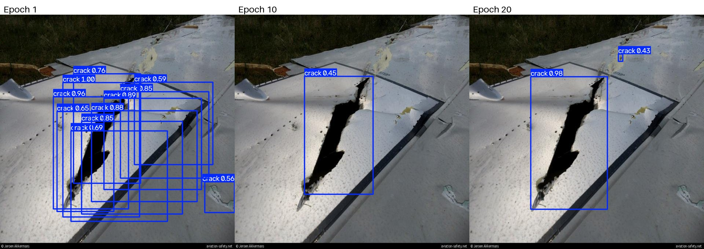
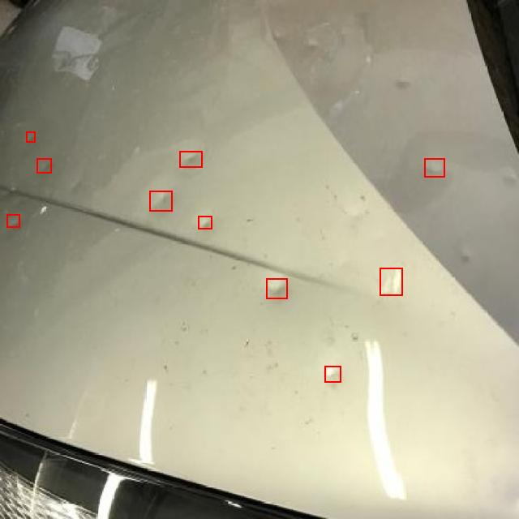
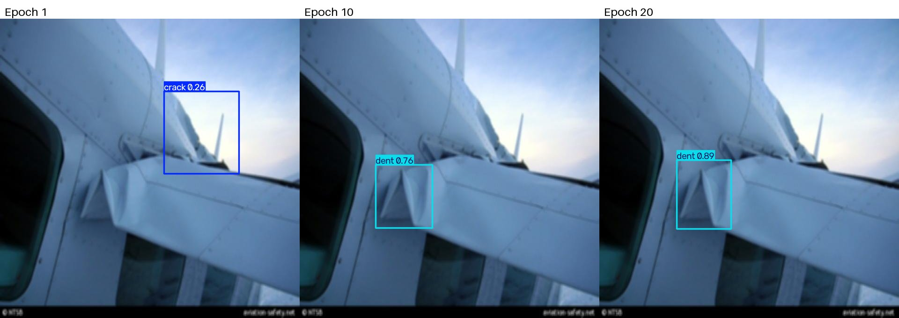
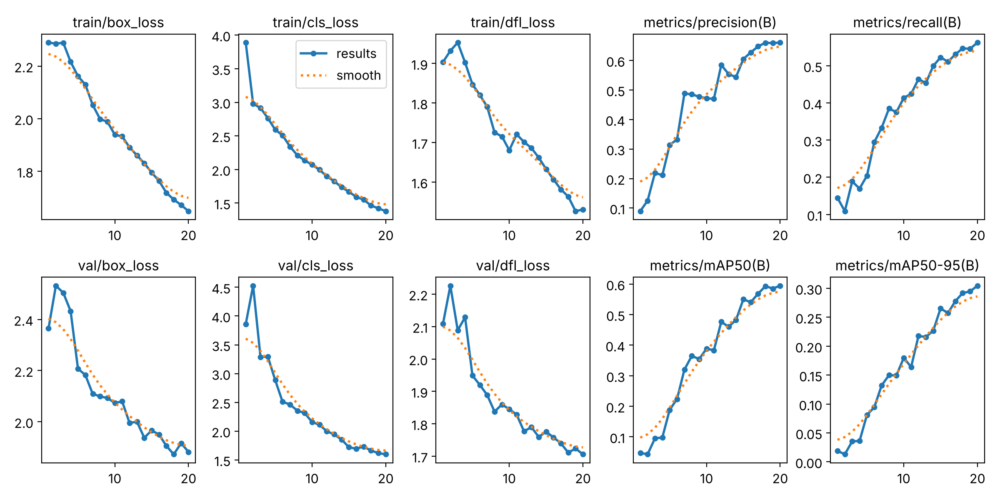
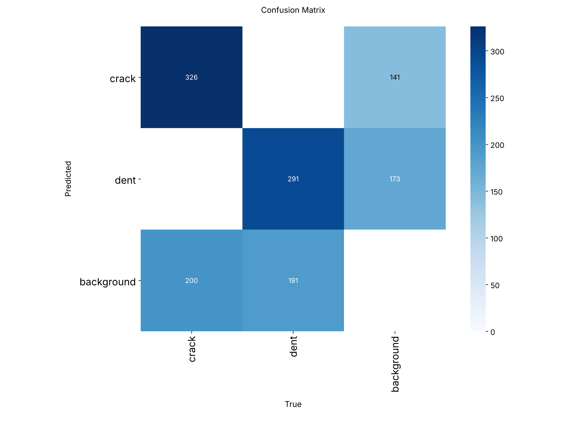
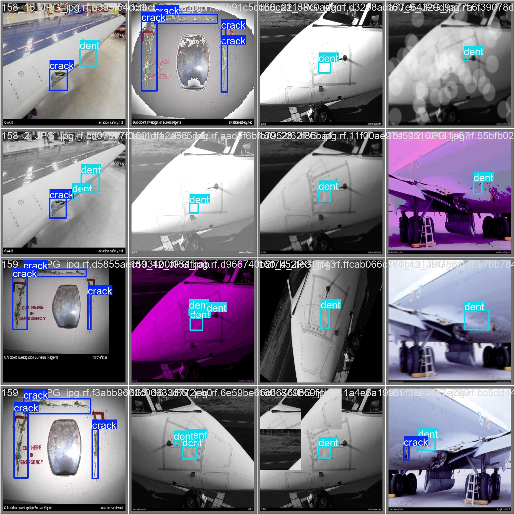
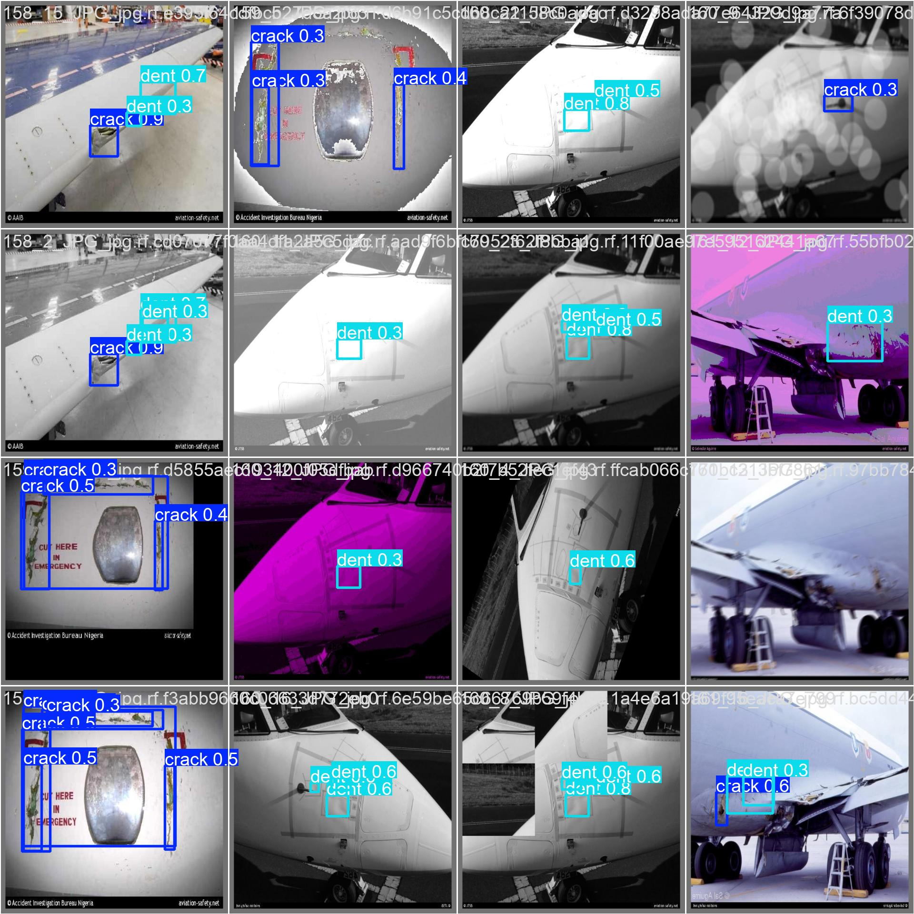
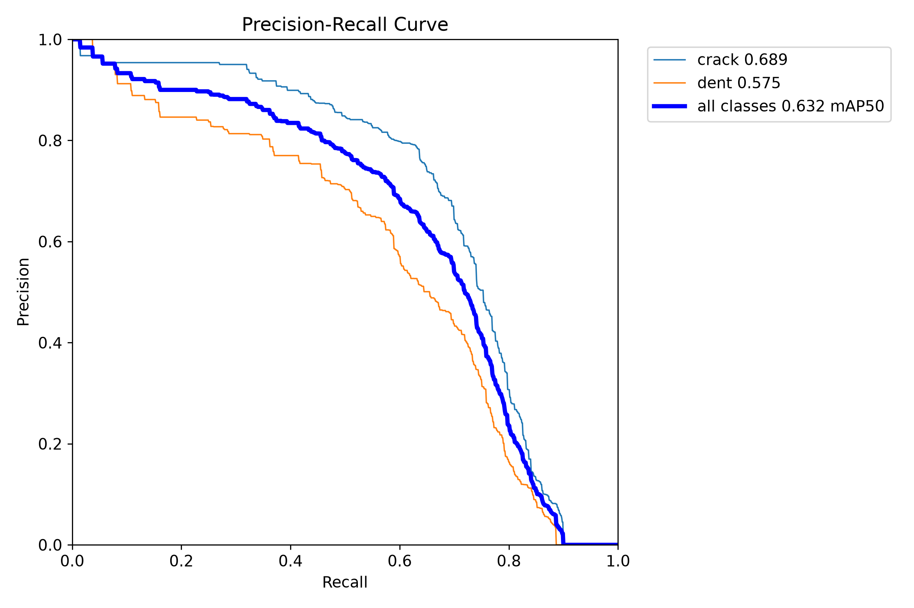

# Aircraft Damage Detector

A computer vision model that finds cracks and dents in photos of aircraft skin. I built it for my ARIN 320 capstone to help maintainers spot damage faster. The model only points at spots worth checking. A human inspector still looks at every spot and makes the final call.



## Why I built this

I work around F/A-18s. When you inspect an aircraft, you are looking at a lot of metal, and a small crack or dent is easy to miss when you are tired or rushed. Missing one can hurt a pilot or a maintainer. So I wanted a helper that looks at a photo and says, check here.

Think of it like a friend with a highlighter. The friend reads the page and highlights the parts that look important. You still read those parts yourself and decide what they mean. The highlighter never signs the paperwork. The inspector does.

## What the model does

You give it a photo. It draws a box around anything that looks like a **crack** or a **dent** and gives a confidence number from 0 to 1. A higher number means the model is more sure.

That is all it does. It does not decide whether the aircraft can fly.

## The short version

**The most important number in this project is at the bottom of this section.** The table below is what I got on the dataset the way it was handed to us. Later I found out that the quiz and exam photos had copies sitting in the training photos, so these scores are way too high. When I fixed that, the honest score dropped to about **0.16 on the practice quiz and 0.06 on the final exam**. See [The honest re-test](#the-honest-re-test).

| On the original split (leaky) | First try | Final model |
|---|---|---|
| Training | 20 epochs on a regular computer | 60 epochs on a graphics card, with fixed labels |
| Practice quiz score (validation mAP50) | 0.588 | **0.632** |
| Final exam score (test mAP50) | 0.630 | **0.672** |
| Cracks it found | 61 percent | **70 percent** |
| Dents it found | 60 percent | **63 percent** |
| Times it mixed up a crack and a dent | 0 | 0 |

All the scores in this table were graded on the same photos, so the comparison is fair. My professor's reference run on this dataset got about 0.58.

| On a clean split (honest) | Practice quiz (validation mAP50) | Final exam (test mAP50) |
|---|---|---|
| Best setup, YOLOv8s, average of 3 runs | 0.158 | **0.056** |

## The honest re-test

After I finished, I asked Google Gemini, ChatGPT and Claude to review this project (see [PROMPTS.md](PROMPTS.md)). All three said the same thing first: split the photos by original photo, so no copy of a quiz or exam photo is in the training pile. So I did that, and then tested the rest of their advice.

### Splitting by original photo

`split_by_source.py` groups every photo with its copies two ways. First by file name, since copies share a number like 158 at the front. Then by how the photo looks: it shrinks every photo to a tiny 32 by 32 gray picture and compares them, flipped and not flipped. I looked at sample pairs by eye to pick the cutoff. That second check caught 47 more copies that had different names.

The surprise: the 3,174 photos come from only **199 different original photos**. Each original was turned into about 16 copies by brightening, darkening, flipping, rotating and cropping.

| Group | Photos | Original photos |
|---|---|---|
| Train | 2,251 | 138 |
| Validation | 471 | 33 |
| Test | 452 | 28 |

No original photo is in more than one group. Cracks and dents are spread about evenly across the groups. The exact split is saved in `results/clean_split_manifest.csv`, so anyone can rebuild it.

### Testing the advice

Every setup was trained 3 times with different random starts (seeds), because one run can get lucky. I picked the winner using only the practice quiz. The final exam photos stayed locked until the very end.

| Setup | Whose idea | Practice quiz mAP50, average of 3 | Lowest to highest run |
|---|---|---|---|
| **Bigger model, YOLOv8s** | ChatGPT and Claude | **0.158** | 0.142 to 0.178 |
| Stronger augmentation | Claude | 0.145 | 0.134 to 0.158 |
| Same settings as before, YOLOv8n | All three | 0.143 | 0.133 to 0.151 |
| Extra weight for the weaker class | My own reading of the Ultralytics docs | 0.141 | 0.130 to 0.154 |
| Freeze the first 10 layers | Claude | 0.113 | 0.098 to 0.125 |

What this tells me:

* **The bigger model did best, but only by a hair.** Its runs overlap with the plain small model. With 3 runs each, I would call it a lean, not a win.
* **Freezing layers did worst, on every run.** Those early layers learned from everyday photos like people and cars. Locking them means they never get to learn what aircraft damage looks like.
* **Stronger augmentation and extra class weight changed nothing overall.** The class weight helped cracks a little and hurt dents a little, so it evened out.
* **The data matters way more than the settings.** Every setup landed between 0.11 and 0.16. Going from the leaky split to the clean split dropped the score from 0.63 to about 0.15.

### The confidence cutoff

Gemini said to lower the cutoff to 0.05 or 0.10. Claude and ChatGPT said to pick it from a goal, like finding 8 out of 10 damage spots. `analyze_threshold.py` checks every cutoff and puts error bars on it by resampling whole original photos.

Bigger model on the practice quiz, average of 3 runs:

| Cutoff | Cracks found | Dents found | False alarms per photo | Photos with damage that got at least one right box |
|---|---|---|---|---|
| 0.05 | 27 percent | 34 percent | 4.0 | 42 percent |
| 0.10 | 21 percent | 29 percent | 1.8 | 35 percent |
| 0.25 (what I used before) | 10 percent | 21 percent | 0.5 | 19 percent |
| 0.50 | 3 percent | 11 percent | 0.1 | 7 percent |

Lowering the cutoff does help. At 0.05 it finds almost 3 times as many cracks as at 0.25. But it also raises 4 false alarms on every photo, and it still misses most damage. Gemini's goal of 95 percent of cracks, and an 8 out of 10 goal, are both out of reach for this model. The error bars are wide too: on one run, crack recall at 0.05 could be anywhere from 13 to 46 percent depending on which photos you happen to test on.

### The final exam, opened once

I tested the bigger model's 3 runs on the 452 test photos one time.

| | Average of 3 runs | Lowest to highest |
|---|---|---|
| Test mAP50 | **0.056** | 0.040 to 0.082 |
| Crack mAP50 | 0.099 | 0.067 to 0.149 |
| Dent mAP50 | 0.013 | 0.012 to 0.015 |
| Cracks found at cutoff 0.05 | 21 percent | |
| Dents found at cutoff 0.05 | 8 percent | |

The exam came out even lower than the quiz, mostly because of dents. I looked into why. **284 of the 461 dents in the test group come from one original photo**, a smooth panel covered in small, faint dents. Looking at it, some dents in that photo do not seem to be marked at all.



The model never saw anything like it in training, so it found almost none of them. With only 28 original photos in the test group, one hard photo can swing the whole score. That is also why ChatGPT said 148 or 452 test photos are not really that many separate tries.

### What I take away from this

The 0.63 was the model remembering photos it had already seen. The honest answer is that 199 photos is not enough for this model to learn cracks and dents well enough to find them on a new aircraft. The fixes that matter most now are more real photos, checking the labels, and maybe a bigger image size so thin cracks do not shrink to almost nothing. Tuning settings will not close a gap this big.

## The pictures it learned from

I used the Aircraft Damage Detection dataset from the youssef-donia-fhktl workspace on Roboflow, version 5 (the one named Extra Finetuning, current best). It has 3,174 photos, and people already marked every crack and dent in them, either with a box or by tracing an outline around it.

| Group | Photos | What it is for |
|---|---|---|
| Train | 2,574 | The model studies these, like homework |
| Validation | 452 | A practice quiz after every round of studying |
| Test | 148 | The final exam, saved until the very end |

**Why version 5?** My professor first gave us a different dataset, and a test run on it only reached a score of about 0.02, which means it could barely learn anything. The professor switched the class to this one because it reached about 0.58. Good pictures with good labels matter more than anything else.

**Why keep the test photos separate?** If you study the exam questions, a perfect score does not prove you learned anything. Keeping the test photos hidden until the end is supposed to show how the model does on photos it has never seen, which is what would happen on a real flight line.

**A catch I found in this dataset.** The dataset makers took each original photo and made several copies of it, a little brighter, darker or flipped, and those copies got spread across all three groups. For example, the same damaged wing (photo 158) shows up 3 times in training and 2 times in validation. All 99 original photos behind the validation pictures and all 37 behind the test pictures also show up in training. So the model has seen a close cousin of almost every quiz and exam photo. That means my scores are higher than what it would get on brand new photos from a real hangar. My professor's 0.58 used the same dataset, so comparing with it is still fair. I later fixed this and measured how much it mattered. See [The honest re-test](#the-honest-re-test).

## Fixing the labels

Every photo comes with a small text file that tells the computer where the damage is. There are two ways to mark damage in that file: a **box** (four numbers that draw a rectangle) or an **outline** (a long list of points that trace around the edge, like tracing a shape with a pencil).

YOLO can use either one, but only one style per photo. **67 photos** (62 training, 3 validation, 2 test) had both styles mixed in the same file. When YOLO sees that, it does not guess. It throws the whole photo out. So my first model never learned from those 67 photos or the 359 damage marks inside them.

The marks were in the right places, so this was a format problem, not a wrong answer problem. There was one small real mistake: in 13 photos, 15 spots were marked twice, once as a box and once as an outline on top of the same damage.

`fix_labels.py` fixes this. It turns every outline into the smallest box that fits around it, and if that new box lands right on top of a box that is already there, it drops it so the damage is not counted twice. After the fix, YOLO uses all 3,174 photos and throws out zero.

## How I trained it

I used **YOLOv8n**, the smallest YOLO model.

**Why YOLO?** YOLO stands for You Only Look Once. It looks at the whole photo one time and finds every object at once, so it is fast. Fast matters if a maintainer is walking around a jet taking pictures.

**Why start from a pretrained model?** It has already seen millions of everyday photos, so it knows what edges, corners and shadows look like. It only has to learn what a crack and a dent look like. That is like teaching someone who already knows how to read a new word, instead of teaching the alphabet first.

**Why a graphics card?** My first try ran on a regular computer processor and took about 6 to 7 minutes for every epoch. On my RTX 2080 Super each epoch took about 18 seconds, so all 60 epochs finished in 19 minutes. A graphics card can do thousands of small math problems at the same time, which is exactly what training needs.

**Why 60 epochs and not more?** One epoch means the model looks at every training photo one time. My first try used 20, and the score was still climbing when it stopped. I tried 60 and then 100. At 100 the model stopped itself at epoch 89 because the practice quiz score had stopped getting better, and its scores came out a little lower than the 60 epoch run. After a point the model starts memorizing the homework instead of learning, so more is not always better.

**Why the small model and not a bigger one?** I also trained the bigger YOLOv8s model. It tied with the small one:

| Model | Practice quiz (validation mAP50) | Final exam (test mAP50) |
|---|---|---|
| First try: small, 20 epochs, old labels | 0.588 | 0.630 |
| Small, 60 epochs, old labels | 0.610 | 0.692 |
| **Small, 60 epochs, fixed labels (final)** | **0.632** | 0.672 |
| Bigger, 60 epochs, fixed labels | 0.623 | **0.695** |
| Bigger, 100 epochs, fixed labels | 0.604 | 0.661 |

The small one won the practice quiz, which has 452 photos. The bigger one won the final exam by a little, but the exam only has 148 photos, so a difference that small could just be luck. The small model is about 3 times smaller and faster, which matters for a tablet on the flight line. So I picked the small one.

## What the Ultralytics docs told me

I went and read the official training guide myself, the [Ultralytics Train mode page](https://docs.ultralytics.com/modes/train/), on November 5, 2026. It explained a few things I had run into, and I checked the settings against the Ultralytics version I used (8.4).

**Why I only used one of my two graphics cards.** My PC has two RTX 2080 Supers, so I expected training to use both. The guide says training on more than one card does not work on Windows with PyTorch 2.4 or newer. The Windows version of PyTorch is missing a piece the cards need to talk to each other. I am on Windows with PyTorch 2.11, so I trained on one card with `device=0`. That is what the guide tells Windows users to do. Using both would mean switching to Linux.

**Why my 100 epoch run stopped at 89.** The setting called `patience` tells training how many epochs to wait for the practice quiz score to get better before giving up. The default is 100. I set it to 15. In that run the score stopped improving, so after 15 epochs with nothing better, it stopped on its own at epoch 89. It is like a coach ending practice early once the team stops getting better.

**How the saved model gets picked.** The guide says the validation score decides which epoch gets saved as `best.pt`. So the model I saved is the epoch with the best practice quiz score, not just the last one. For the run that stopped at 89, the saved model came from an earlier, better epoch. This is also why the test photos have to stay out of these choices.

## How it got better

Every epoch the model took a practice quiz on the validation photos. The score here is **mAP50**. In plain words, it asks: when the model drew a box, was it in the right spot and did it pick the right label? It goes from 0 (always wrong) to 1 (perfect). These numbers come from the final model's training log in `results/results.csv`.

| After epoch | mAP50 | What was happening |
|---|---|---|
| 1 | 0.05 | Guessing |
| 10 | 0.31 | Starting to find some damage, still missing most of it |
| 20 | 0.37 | Finding more, but a lot of misses |
| 30 | 0.53 | Big jump, finding about half of the damage |
| 40 | 0.59 | Passing the professor's 0.58 |
| 50 | 0.61 | Slowing down, small gains |
| 60 | **0.63** | Done |

The pictures at the top and below come from my first try, when I saved the model at epoch 1, 10 and 20. At epoch 1 it drew a pile of messy crack boxes around the hole in the wing. By epoch 10 it found the crack with one box but was not very sure (0.45). By epoch 20 it was almost certain (0.98). In the dent photo, at epoch 1 it put a crack box on open sky near the tail. By epoch 20 it found the real dent and called it a dent. The final model finds both of these the same way (crack 0.92, dent 0.88). Where it got better is on the harder photos, as the scoreboard below shows.



This chart shows all 60 epochs of the final model. The loss charts going down mean it is making fewer mistakes. The mAP charts going up mean it is getting more right.



## Final results

| | Validation | Test |
|---|---|---|
| mAP50 | 0.632 | 0.672 |
| Precision | 0.69 | 0.69 |
| Recall | 0.61 | 0.64 |

| Damage type | Validation mAP50 | Test mAP50 |
|---|---|---|
| Crack | 0.69 | 0.68 |
| Dent | 0.57 | 0.67 |

**Precision** answers: when the model says damage, how often is it right? About 7 times out of 10.

**Recall** answers: out of all the real damage, how much did the model find? About 6 out of 10.

That recall number is the most important thing in this whole project. **The model still misses about 1 out of every 3 damage spots.** That is exactly why it can only be a helper. If an inspector trusted it alone, damage would get missed. Used the right way, as a second set of eyes that points at places to look, it can still catch things a tired person might walk past.

## The confusion matrix

A confusion matrix is a scoreboard that shows every time the model was right, every time it was wrong, and what kind of wrong it was. I ran it on the 452 validation photos with the same setting `detect.py` uses: the model only counts a box if it is at least 25 percent sure.



How to read it: each **column** is the truth (what was really in the photo). Each **row** is what the model said. Background means nothing there.

| | Really a crack | Really a dent | Really nothing |
|---|---|---|---|
| Model said crack | **376** right | 0 | 155 false alarms |
| Model said dent | 0 | **303** right | 198 false alarms |
| Model said nothing | 162 missed | 181 missed | |

What this tells me in plain words:

* **It never mixed up a crack and a dent.** Those two boxes are 0. When it finds damage, it names it correctly.
* **It found 376 of 538 cracks (70 percent) and 303 of 484 dents (63 percent).** The other 343 spots it walked right past. That is the about 1 in 3 missed from above.
* **It raised 353 false alarms**, drawing a box where nothing was marked. I have not gone through each one, so I cannot say yet what fooled it. Some could even be real damage the person labeling the photos skipped.
* **Dents are harder than cracks.** It finds fewer dents and has more false alarms on dents. That makes sense, because a dent is a soft change in shape that can look a lot like a shadow or a curve in the metal.

Compared with my first try graded on these same photos (328 cracks and 292 dents found, 316 false alarms), the final model found 48 more cracks and 11 more dents, with 37 more false alarms. Finding more damage in exchange for a few more false alarms is the right trade for this job. A false alarm costs an inspector a few seconds. A miss could cost a lot more.

The big lesson: the problem is not that the model gets confused. The problem is that it does not see everything. That is a lot safer for a helper tool, because a missed spot still gets looked at by the inspector who walks the whole aircraft anyway.

## Model guesses next to the answer key

The left picture is what the people who made the dataset marked. The right picture is what my final model found on the same photos. You can spot both the hits and the misses yourself.

| Answer key | Model guesses |
|---|---|
|  |  |

## Precision and recall together



This chart shows a trade. If you make the model more careful (only show boxes it is very sure about), you get fewer false alarms but it misses more damage. If you make it less careful, it finds more damage but cries wolf more often. The bigger the area under the line, the better the model. The crack line sits above the dent line, which matches the scoreboard: cracks are easier for it. For an inspection helper I would rather it be a little less careful, because a false alarm costs an inspector a few seconds and a miss could cost a lot more.

## Why it will never score a perfect 1.0

A 1.0 would mean every box in the right spot on every crack and dent, with zero misses and zero false alarms. That does not happen on real photos:

* The answer key is drawn by people, and two careful inspectors would not draw the exact same box around a crack.
* Some damage is really hard to see, like tiny cracks, glare or blurry photos.
* Training longer eventually makes it worse, because it starts memorizing instead of learning. My 100 epoch run proved that.

The biggest gains from here would come from more and better labeled photos, especially real inspection photos, not from more epochs.

## What to keep in mind

* It was trained on general aircraft photos from the internet, not F/A-18 inspection photos. Before anyone used something like this for real, it would need to be retrained and tested on photos from that aircraft.
* It only knows two things, cracks and dents. It has never been taught corrosion, missing fasteners or anything else.
* The scores on the original split are far too high because of the photo copies spread across the groups. On a clean split the model scores about 0.06 on the final exam (see The honest re-test above). It is not ready to help a real inspector.

## Try it yourself

```
pip install -r requirements.txt
python detect.py your_photo.jpg
```

The trained model is in `model/best.pt`. To train it again from scratch, download the dataset (version 5, YOLOv8 format), unzip it into a folder called `data` next to these files, and run:

```
python fix_labels.py
python train.py
python evaluate.py
```

`train.py` uses the first graphics card. If you do not have one, change `device=0` to `device="cpu"` and plan on most of a day.

To run the honest re-test instead:

```
python fix_labels.py
python split_by_source.py --use-manifest
python check_labels.py data_clean
python run_experiments.py --gpu 0 --runs A_base_s0,B_v8s_s0
python analyze_threshold.py clean_results/B_v8s_s0_best.pt valid
python final_test.py
```

On Windows with two cards, keep `--workers` at 3 or less. With 8 helpers per card, my PC ran out of memory.

## How I use AI to check my work

This is an AI class, so I also wrote down how I use GenAI tools to learn instead of doing the work for me. [PROMPTS.md](PROMPTS.md) has my professor's four part prompt method (Role, Task, Context, Format), the six prompts that go with it, and a filled in prompt that asks Google Gemini, ChatGPT, or Claude to review this project and tell me what it would do differently. It also has the reviews Google Gemini, ChatGPT, and Claude gave back, with screenshots, my notes on what I checked, and a table comparing all three.

## Files

| File | What it is |
|---|---|
| `fix_labels.py` | Turns the mixed outline labels into boxes so no photos get thrown out |
| `check_labels.py` | Checks every label file before training and stops if one would get skipped (Gemini's idea) |
| `split_by_source.py` | Makes the clean split so no original photo is in two groups |
| `run_experiments.py` | Trains every setup from the AI reviews 3 times on the clean split |
| `analyze_threshold.py` | Checks every confidence cutoff with error bars |
| `final_test.py` | Opens the test photos one time for the winning setup |
| `train.py` | Teaches the model |
| `evaluate.py` | Grades the model on validation and test photos |
| `detect.py` | Runs the model on your own photo |
| `PROMPTS.md` | The prompt method I use with GenAI, plus a ready to paste project review prompt |
| `model/best.pt` | The final trained model |
| `model/first_model_20_epochs.pt` | My first try, kept so you can compare |
| `model/clean_split_v8s.pt` | The best model from the honest re-test (YOLOv8s, seed 0) |
| `results/results.csv` | The score for every epoch of the final model |
| `results/results.png` | Chart of all 60 epochs |
| `results/confusion_matrix.png` | Scoreboard of hits, misses and false alarms on the validation photos |
| `results/precision_recall_curve.png` | The trade between false alarms and misses |
| `results/eval_report.json` | Every final number in one file |
| `results/first_run/` | The same charts and log from my first try |
| `results/ai_review/` | Screenshots of the project reviews from Google Gemini and ChatGPT |
| `results/clean_split_manifest.csv` | Every photo, which original it came from, and which group it is in |
| `results/clean/` | Scores for all 15 re-test runs, the cutoff checks and the one time final exam |
| `results/images/` | Before and after pictures, plus model guesses next to the answer key |

## Credits

Dataset: Aircraft Damage Detection (Roboflow workspace youssef-donia-fhktl), version 5, Roboflow Universe, CC BY 4.0. https://universe.roboflow.com/youssef-donia-fhktl/aircraft-damage-detection-1j9qk/dataset/5

Photos in the dataset carry their original photographer credits (for example aviation-safety.net) in the corner of each image.

Model: YOLOv8 by Ultralytics.
